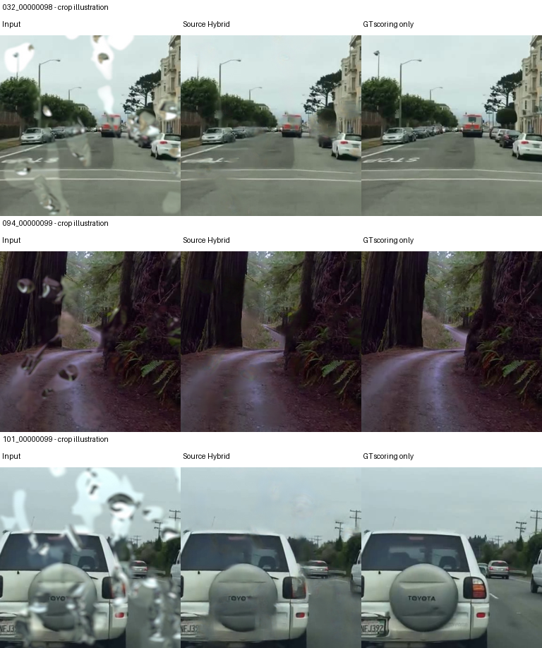

# Muaxla — Kết quả phục hồi ảnh mưa

Bộ kết quả và công cụ chạy **Hybrid gốc** được giữ lại từ nghiên cứu phục hồi ảnh mưa Muaxla.

**Trạng thái:** các nhánh thử bổ sung chưa đạt mục tiêu cải thiện thêm5%; chưa tuyên bố phục hồi hoàn toàn hoặc có đánh giá test cuối mới. Chi tiết và số liệu nằm trong [báo cáo](ket-qua-hoi-phuc/Bao_cao_ket_qua.md).

## Tải toàn bộ trong một file

➡️ [Ket_qua_hoi_phuc_v1.zip — model + mã + báo cáo + ảnh](https://github.com/Binum95h1/muaxla-raindrop-restoration/releases/download/v1.0.0/Ket_qua_hoi_phuc_v1.zip)

Hoặc mở [trang Release v1.0.0](https://github.com/Binum95h1/muaxla-raindrop-restoration/releases/tag/v1.0.0). ZIP có đầy đủ model57MB, mã chạy,13báo cáo,18ảnh so sánh và bảngSHA256. Trọng số nằm trong ZIP để repo mã nguồn gọn.

## Cách chạy

1. Tải và giải nén ZIP.
2. Mở terminal tại `ket-qua-hoi-phuc/Hybrid_goc`.
3. Dùng môi trường Python có PyTorch phù hợp CPU/CUDA,NumPy,Pillow; các gói cần thiết được liệt kê trong `requirements.txt`.
4. Chạy:

```powershell
python Phuc_hoi_anh.py --input "D:\Anh_mua" --device cuda
```

Không cóCUDA thì chọn `--device cpu`. Input nhận một ảnh hoặc thư mục ảnh. Kết quả mặc định nằm trong `Anh_da_phuc_hoi` cạnh `Hybrid_goc`; đổi nơi xuất bằng `--output`. Ảnh gốc được giữ và chương trình từ chối ghi đè kết quả đã có. Đây là công cụ xử lý ảnh, chưa phải pipeline video thời gian thực.

Mã trong [ket-qua-hoi-phuc](ket-qua-hoi-phuc) cũng dùng được trực tiếp: chép `best.pt` từ ZIP vào cùng thư mục với `Phuc_hoi_anh.py` trước khi chạy.

## Kết quả đã xác minh

| Phương án | ROI MAE ↓ trên native18/9scene |
|---|---:|
| Hybrid gốc được giữ |0.028461868771|
| Video reconstruction2000 |0.028462076818|
| Lặp centralframe cùng trọng số |0.028462083855|

Video không cải thiện đáng kể; Hybrid gốc tiếp tục được giữ. Native18 là validation lặp lại, không phải test độc lập/fullvalidation900. [CSVtổng hợp](ket-qua-hoi-phuc/ket_qua_tong_hop.csv) và cácCSVtừngảnh đi kèm mã.

## Minh họa Hybrid

Mỗi hàng: **Input / Source Hybrid / GT**. Đây là crop384thu nhỏ256 để minh họa, không phải ảnh phục hồi toàn kích thước; mờ/vệt vẫn còn ở những vùng khó.



## Nguồn và tính toàn vẹn

- CheckpointHybrid SHA256: `cb5f8f3f7d7c1fdd9d74298f000d29850655b89bd98364a6a3d7a426017edda2`.
- Tile384,overlap128,FP32. Không thay bằng model video thử nghiệm.
- Mã kế thừa và thích nghi từ Restormer; [giấy phépMIT của mã gốc](ket-qua-hoi-phuc/Restormer_LICENSE.txt) được giữ nguyên. Không tuyên bố tái lập nguyên bản EDVR/STRRNet hay kiến trúc khác.
- [Thông tin model](ket-qua-hoi-phuc/Thong_tin_model.json). FileSHA256 trong ZIP giúp kiểm tra các file sau tải. File tạm/cache/mật khẩu và dữ liệu train đầy đủ không nằm trong repo.
